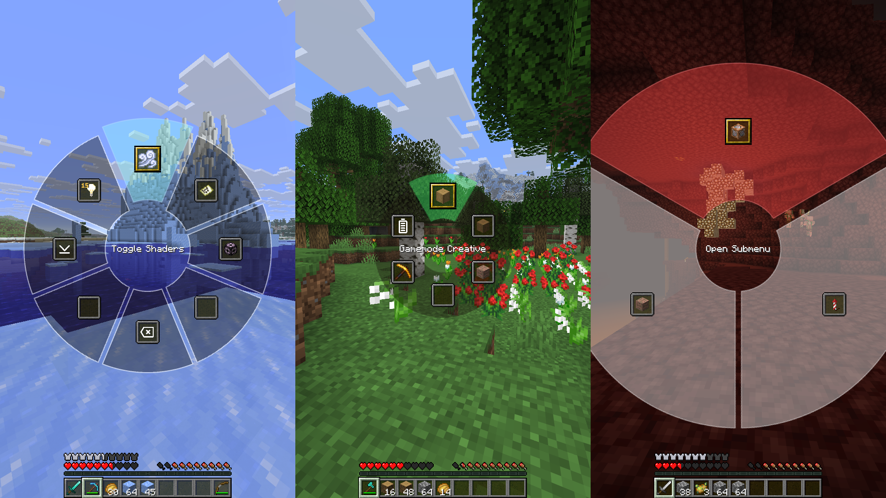
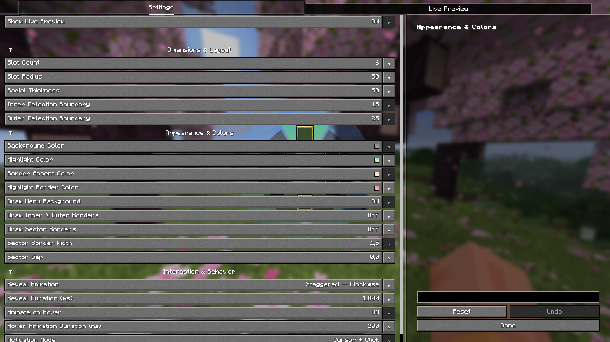
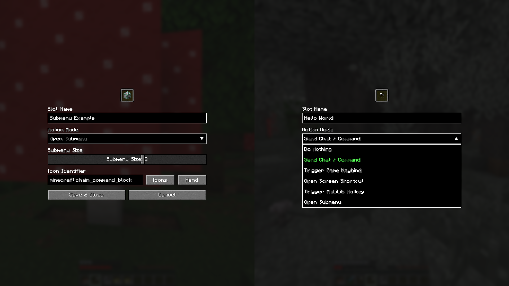
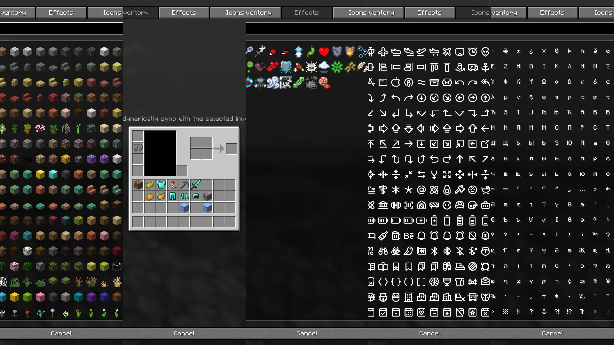

<div align="center">


# Radial

<a href="https://github.com/Mingmyal/radialmenu">
  
</a>


***A simple and opinionated Minecraft radial menu mod that works flawlessly out of the box.***

</div>

## Overview
**Radial** is an opinionated utility mod that brings all your commands and keybinds into one beautifully simple interface. Built for seamless gameplay, it eliminates the need to memorize complex hotkeys by putting your most-used actions in a dynamic radial menu that just works.


## Features

### It's a radial menu

A fast, fluid interface built for speed. Execute actions on click or release, depending on your playstyle. Need to make a quick change? Just right-click any slot to edit it on the fly.

### Complete visual control

Make it yours with a real-time live preview. Adjust the radius, change colors, tweak gaps, or hide the background donut entirely to perfectly match your HUD.

### Various functionalities

Bind your slots to whatever you need. Set up chat commands, standard keybinds, submenus, screen shortcuts (like instantly opening the Options menu), or even MaLiLib keybinds for technical players. Name them, or leave them blank for a minimalist look.

### Icon customization

Represent your actions your way. Choose from any item (full NBT support included), sync visually with live inventory slots, display mob effect icons, Phosphor icons, or type out custom character combinations.

## Server-side settings

A server owner can configure the radial menu once and have every player use it automatically.

### How it works

1. Install this mod on the **server** as well as the client. It is a universal (`environment: "*"`) mod, so the same jar works on both sides.
2. A server owner / OP opens the main radial settings and clicks **Apply as Server Settings**.
   This uploads the settings they are currently using as the server config (`config/radialmenu-server.json`, same format as the client's `radialmenu.json`) and starts distributing it. Clicking it again overwrites the server config with their current settings.
3. Every player who joins applies the server configuration automatically.

The two server-wide switches live in `config/radialmenu-server-control.json`, separate from the configuration file itself, because that file's format must stay identical to the client's.

| Setting | Effect |
| --- | --- |
| **Apply as Server Settings** | Uploads and distributes the server configuration to everyone. |
| **Force Clients To Use Server Settings** | Everyone uses the pristine server configuration. Players cannot customise it or switch back to their own settings. Requires the first setting to be on. |

### Three configurations on the client

Players end up with three separate configurations, which keeps things predictable:

| Configuration | File | When it is used |
| --- | --- | --- |
| **Client global** | `config/radialmenu.json` | Your own settings, independent of any server. Used when the server is not applying its config, or when you switch back to client settings. |
| **Per-server custom copy** | `config/radialmenu-servers/<server>.json` | Used when the server applies its config without forcing. You may customise it freely — it is **yours**, and stored per server so different servers never overwrite each other. |
| **Pristine server config** | `config/radialmenu-servers/<server>.forced.json` | Used only when the server forces its settings. Re-downloaded on every join and held in memory; editing it has no effect. The on-disk file is a copy for reference only. |

Because the custom copy is per server, customising your radial menu on one server never leaks into another.

The **Switch To Client / Server Settings** button moves you between the server-provided configuration and your own global one. It is a purely personal choice and needs no permission — switching to the server's settings only affects you. The server refuses the switch while **Force Clients To Use Server Settings** is on.

If an operator updates the server configuration, your custom copy is rebuilt from the new one automatically, so server-side changes are never masked by a stale custom copy.

### Permissions

There are **no permission nodes**. Everything is decided by the vanilla **operator permission level** (level 4 by default), so no permissions mod is needed.

| Action | Who |
| --- | --- |
| Apply / upload the server config, toggle **Force Clients To Use Server Settings** | OP only |
| `/radialmenu-server reload`, `/radialmenu-server status` | OP only |
| Switch between server settings and your own client settings | Everyone — it affects only you |
| Edit slots (right-click a slot, change any setting) | Everyone, **except** while the server is forcing |
| Enter edit mode (the `K` key) | Everyone, **except** non-OPs while the server is forcing |
| Open the settings screen (menu centre, or `N`) | Everyone, **except** non-OPs while the server is forcing |

While **Force Clients To Use Server Settings** is on, **nobody can edit slots or settings** — including operators. That is deliberate: the forced configuration lives in memory only, so an edit could not be saved, and allowing it would look like it worked and then silently vanish.

Operators keep the `K` key on purpose. Edit mode is how you reach the settings screen by clicking the menu centre, and `N` is not discoverable — disabling `K` would leave operators unable to find the switch that turns forcing back off. So an operator can still enter edit mode, click the centre, and use the force switch there; only the slot-editing actions are refused, with a red message explaining why.

To change a forced configuration:

1. Open the settings (menu centre, or `N`) and turn **Force Clients To Use Server Settings** off.
2. Edit the radial menu as usual.
3. Click **Apply as Server Settings** to upload it.
4. Turn the force switch back on.

Server-related options are hidden rather than greyed out, so the settings screen only shows what actually applies:

| Option | Shown when |
| --- | --- |
| **Apply as Server Settings** | Multiplayer, you are an OP, and the server is not forcing |
| **Force Clients To Use Server Settings** | Multiplayer and you are an OP (always, so it can be turned back off) |
| **Switch To Client / Server Settings** | Multiplayer, the server is distributing a config, and it is **not** forcing |
| All local settings (layout, colours, text, behaviour, preview) | The server is **not** forcing |

In singleplayer no server option is shown at all — singleplayer always uses your own config. That is deliberate: a singleplayer world shares the same `config` folder as the client, so a leftover `radialmenu-server.json` (say, copied from a server) would otherwise be distributed by the integrated server with no way to turn it off from the UI.

Operator status is read live from the client's own permission level, which vanilla keeps up to date the moment someone is opped or de-opped — so there is nothing to reload and no cached-permission staleness.

\* The required level is level 4 by default; it changes if a server sets `op-permission-level` in `server.properties`.

### If the buttons do nothing

Check the server log on join. The server prints one line per sync:

```
Sync radial config to <player>: isOp=true, applied=false, force=false, available=true
```

`isOp=false` for an operator means the server is not seeing them as OP — check `op-permission-level` and that the player is actually in `ops.json`. If **no such line appears at all**, the server does not have the mod installed (or is running an older version), and the client reports *"The server does not have the Radial mod"* when a button is clicked.

### Commands

| Command | Description |
| --- | --- |
| `/radialmenu-server reload` | Re-read the configuration and control files from disk, then resync everyone |
| `/radialmenu-server status` | Report whether a configuration is loaded, and the state of both switches |

## Version Support & Backports

To keep development focused and maintain a healthy workflow, this mod operates on a **forward-only** development cycle.

- **Active Development:** I am currently only developing and testing for the newest targeted Minecraft version. New features, improvements, and bug fixes will only be applied to this latest version.
- **No Backporting:** I do not backport features or patch bugs for older versions of Minecraft.
- **Older Releases:** Past versions of the mod will remain available to download for players using older modpacks, but they are provided "as-is" and will not receive further updates.
- **Community Contributions:** If you are passionate about a specific older version, feel free to fork the repository and submit a Pull Request! I am more than happy to review and accept community-driven backports, bug fixes, or maintenance updates for older versions.
